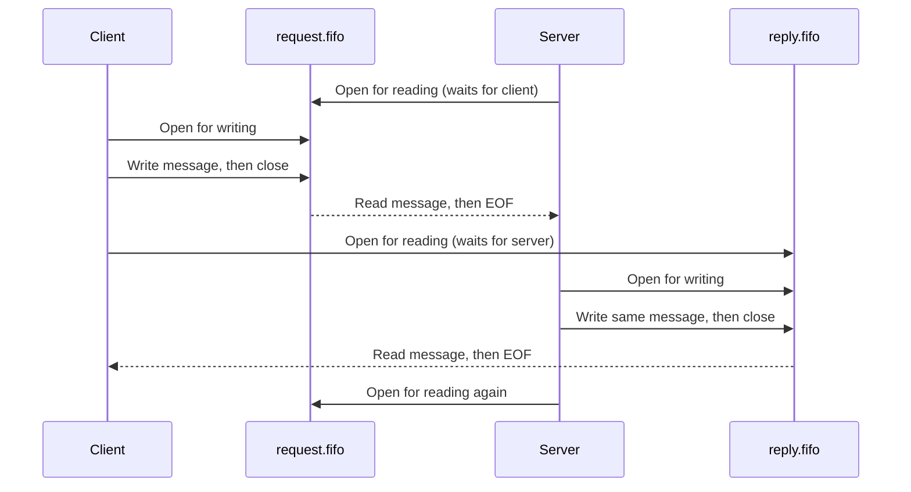

# FIFO echo demo (macOS)

Build both programs:

```sh
clang++ -std=c++17 -Wall -Wextra -o server server.cpp
clang++ -std=c++17 -Wall -Wextra -o client client.cpp
```

In one terminal, run the server from this directory:

```sh
./server
```

In another terminal, from the same directory:

```sh
./client "hello from the client"
```

The client prints `Server replied: hello from the client`. Run the client again
with another message; the server keeps listening. Press Ctrl+C to stop it.

## Message sequence



The server creates `request.fifo` and `reply.fifo` in the current directory.
The client writes a message to the request FIFO and closes it; the server reads
until EOF, then writes the same bytes to the reply FIFO. This small demo handles
one client at a time. After stopping the server, you can remove the FIFO files
with `rm request.fifo reply.fifo`.

## Why `open` waits

All FIFO opens in this demo use the default blocking mode. Opening a FIFO with
`O_RDONLY` waits for a writer, and opening it with `O_WRONLY` waits for a reader.
That is why the server can wait in `open(request.fifo, O_RDONLY)` for a client,
and the client can wait in `open(reply.fifo, O_RDONLY)` for the server. If the
FIFO files exist but the server is not running, the client can wait indefinitely
while opening `request.fifo` for writing.

With `O_NONBLOCK`, a read-only open returns immediately; a write-only open fails
with `ENXIO` when no reader has opened the FIFO.
